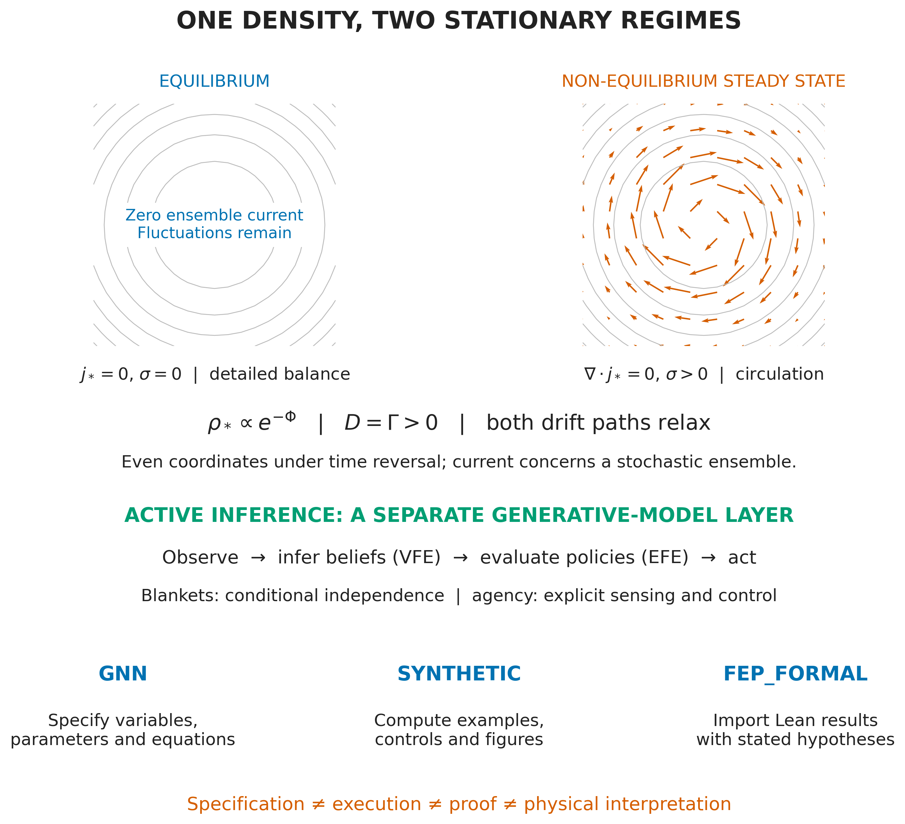

# Active Inference — A Synthetic Overview

[](https://github.com/docxology/ActiveInferenceSynthetic/actions/workflows/checks.yml)
[](https://doi.org/10.5281/zenodo.23396307)

ActiveInferenceSynthetic is an executable teaching paper introducing Active
Inference across equilibrium and non-equilibrium settings. Its Python
demonstrations cover Bayesian inference, action selection, planning, Markov
blankets, hierarchical inference, and the value of information. Tested numerical
examples, selected Lean proofs, reproducible figures, a manuscript PDF, and a
twenty-minute narrated lecture make the models and their assumptions explicit.

**Daniel Ari Friedman and Alexandra Mikhailova · Active Inference Institute**

[Read the paper](ActiveInferenceSynthetic_Revised.pdf) ·
[Watch/download the lecture](https://github.com/docxology/ActiveInferenceSynthetic/releases/download/synthetic-public-v0.6.1/ActiveInferenceSynthetic_20min.mp4) ·
[Documentation](docs/README.md) ·
[Zenodo archive](https://zenodo.org/records/23396307)



## Read, watch, reproduce

| Resource | Repository copy | Archived download |
| --- | --- | --- |
| Revised paper | [28-page PDF](ActiveInferenceSynthetic_Revised.pdf) | [Release PDF](https://github.com/docxology/ActiveInferenceSynthetic/releases/download/synthetic-public-v0.6.1/ActiveInferenceSynthetic_Revised.pdf) |
| Daniel lecture | [Twenty-minute MP4](ActiveInferenceSynthetic_20min.mp4) | [1080p video](https://github.com/docxology/ActiveInferenceSynthetic/releases/download/synthetic-public-v0.6.1/ActiveInferenceSynthetic_20min.mp4) |
| Linked slides | [Slide PDF](media/synthetic/slides.pdf) | [Release slides](https://github.com/docxology/ActiveInferenceSynthetic/releases/download/synthetic-public-v0.6.1/ActiveInferenceSynthetic_Slides.pdf) |
| Captions | [SRT](media/synthetic/captions.srt), [WebVTT](media/synthetic/captions.vtt) | Included with the release |
| Narration | [Transcript](media/synthetic/transcript.txt), [speaker notes](media/synthetic/speaker_notes.md) | Included in the source archive |
| Frozen lecture replay | [Replay instructions](docs/lecture.md) | [Recordings, inputs and runtime](https://github.com/docxology/ActiveInferenceSynthetic/releases/download/synthetic-public-v0.6.1/ActiveInferenceSynthetic_Reproducibility.zip) |
| Archived repository | [Publication guide](docs/publication.md) | [Source ZIP, distribution 0.6.1](https://github.com/docxology/ActiveInferenceSynthetic/releases/download/synthetic-public-v0.6.1/ActiveInferenceSynthetic_Source_v0.6.1.zip) |

The PDF and MP4 are ordinary root files. [publication.json](publication.json)
and [SHA256SUMS.txt](SHA256SUMS.txt) bind their exact bytes and media companions.
GitHub may require downloading the video for playback.

The [0.6.1 release](https://github.com/docxology/ActiveInferenceSynthetic/releases/tag/synthetic-public-v0.6.1)
and [Zenodo record](https://zenodo.org/records/23396307) are fixed archival
snapshots. Development documentation and tooling on `main` can advance beyond
them; use the archived source ZIP to reproduce that exact distribution.
[CHANGELOG.md](CHANGELOG.md) separates unreleased changes from archived versions.

## Quick start

Requirements: Python **3.10+** and [uv](https://docs.astral.sh/uv/getting-started/installation/).
The numerical examples need no provider credentials, template checkout, Lean,
or GNN installation.

```bash
git clone https://github.com/docxology/ActiveInferenceSynthetic.git
cd ActiveInferenceSynthetic
uv sync --locked --extra dev
uv run python -c "from active_inference_synthetic.synthetic_agent import synthetic_agent_demo; print(synthetic_agent_demo(observation=1).commitment.choice)"
```

The example prints `1`: the informative observation changes the next commitment.

```bash
uv run python scripts/verify_publication.py
uv run python scripts/generate_all_figures.py
uv run python scripts/run_teaching_experiments.py
uv run pytest tests/ --cov=src --cov-fail-under=90
```

Generated figures, hydrated manuscript sections and experiment reports appear
under `output/`. The publication verifier needs a Git checkout.
See [the full quick start](docs/quickstart.md) for installation modes,
[troubleshooting](docs/troubleshooting.md) for failures, and
[CONTRIBUTING.md](CONTRIBUTING.md) for the development workflow.

## What the examples teach

| Question | Demonstration | Start here |
| --- | --- | --- |
| What explains an observation? | Bayesian conditioning and variational-free-energy descent | [Generative model](src/generative_model.py) |
| Which action or sequence should follow? | One-step EFE, finite-history planning and an explicit normalization bridge | [Action](src/expected_free_energy.py), [planning](src/policy_planning.py) |
| When is information useful? | Feedback utility, acquisition cost, and irrelevant-payoff controls | [Decision value](src/value_of_information.py) |
| How does an observation change behavior? | Informative and uninformative cue/commitment episodes | [Synthetic agent](src/synthetic_agent.py) |
| How do levels of a model interact? | Exact context/state prediction and joint conditioning | [Hierarchy](src/hierarchical_model.py) |
| What is a statistical boundary? | Gaussian marginal dependence and conditional independence | [Markov blanket](src/markov_blanket.py) |
| How do relaxation and steady circulation differ? | Deterministic trajectories, matched-noise OU current and entropy production | [Trajectories](src/trajectories.py), [steady state](src/steady_state.py) |

[Methods](docs/methods.md) explains carriers, units and analytical controls;
[the manuscript](docs/manuscript/README.md) develops the teaching sequence.
These are controlled model demonstrations. Persistent current alone does not
establish life or intelligence, and informational VFE/EFE do not become physical
free energy through shared terminology.

## Numerical, formal and rendering boundaries

- **Python:** deterministic numerical examples, figures and manuscript hydration.
  Installed imports use `active_inference_synthetic`; checkout scripts use `src`.
- **Lean:** selected real-valued results from the pinned
  [fep_formal](https://github.com/ActiveInferenceInstitute/fep_formal) `FepSketches`
  library, with paper-specific adapters and explicit hypotheses. Follow
  [formal setup](formal/README.md); native checks require its exact toolchain and dependencies.
- **GNN:** [authored optional specifications](data/gnn/README.md) and a real-parser
  bridge. Parsing does not establish backend equivalence.
- **Paper rendering:** the separate research template supplies PDF/HTML rendering.
  [Rendering instructions](docs/rendering_pipeline.md) identify the required link and tools.
- **Lecture replay:** the frozen bundle supplies measured recordings and a scoped
  LectureCreate runtime. A source clone alone does not include those replay inputs.

[STANDALONE.md](STANDALONE.md) and [project positioning](docs/positioning.md)
define these boundaries. The Python CI badge covers numerical, publication,
lint, type and packaging checks; native Lean proof verification remains separate.
Missing native tools produce explicit test skips, not evidence of verified proofs.

## Repository map

| Path | Responsibility |
| --- | --- |
| [src/](src/README.md) | Numerical models and figure builders |
| [scripts/](scripts/README.md) | Figure, experiment, hydration and verification entry points |
| [tests/](tests/README.md) | Real-computation and file-based controls |
| [formal/](formal/README.md) | Pinned Lean adapters, witnesses and axiom checks |
| [docs/](docs/README.md) | Reader/developer guides and authored manuscript |
| [data/](data/README.md) | Claim ledger and GNN model inputs |
| [media/](media/README.md) | Lecture companions and frozen authoring sources |
| [.github/](.github/workflows/README.md) | Automated Python checks and their scope |

Every maintained folder has a README and AGENTS guide.
[AGENTS.md](AGENTS.md) defines contributor-agent boundaries;
[ISA.md](ISA.md) and [TODO.md](TODO.md) record purpose and implemented scope.

## Cite and reuse

Use GitHub's **Cite this repository** menu or [CITATION.cff](CITATION.cff).
For the archived paper and public distribution:

```bibtex
@article{friedman2026synthetic,
  author = {Friedman, Daniel Ari and Mikhailova, Alexandra},
  title = {Active Inference -- A Synthetic Overview},
  year = {2026},
  version = {0.6.1},
  doi = {10.5281/zenodo.23396307},
  url = {https://zenodo.org/records/23396307}
}
```

Scientific package/manuscript version is **0.5.0**; archived distribution is
**0.6.1**, reusing lecture **edition_v15** from teaching release **0.6.0**.
The [publication guide](docs/publication.md) explains which identity to cite.

The project declares **CC-BY-4.0** in its archival/citation metadata.
[LICENSE](LICENSE) contains the full license text. Retain attribution and
identify modifications when reusing project material; external dependencies
and referenced works retain their own terms.
