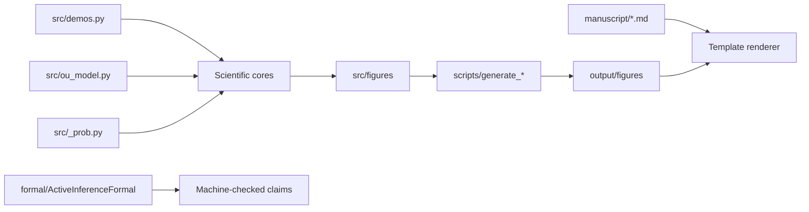

# Architecture

## Boundaries

- `src/_prob.py`: probability validation and KL only.
- `src/ou_model.py`: canonical isotropic OU/Bayesian-mechanics parameter model.
- Scientific cores: generative model, EFE, flow, trajectories, blanket, NESS.
- `src/figures/`: importable presentation logic and output manifest.
- `scripts/`: thin CLI-compatible wrappers.
- `formal/`: independent Lean 4 side-spec for load-bearing theorems.
- `tests/`: real numerical references, rendering smoke tests, Lean build checks.

`gamma == 0` is valid for deterministic Hamiltonian flow. Stationary diffusion
quantities require `gamma > 0`, enforced by `IsotropicOU.require_positive_gamma`.
