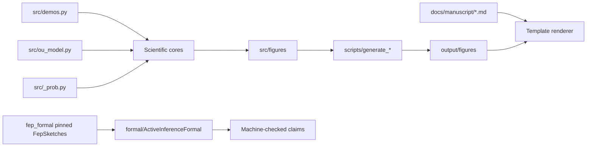

# Architecture

## Boundaries

- `src/_prob.py`: probability validation and KL only.
- `src/ou_model.py`: canonical isotropic OU/Bayesian-mechanics parameter model.
- Scientific cores: generative model, one-step EFE, multi-step policy planning,
  flow, trajectories, blanket, NESS, closed-loop commitments, hierarchical
  inference, and the normalized history-channel bridge.
- `src/figures/`: importable presentation logic and output manifest.
- `scripts/`: thin CLI-compatible wrappers.
- `formal/`: independent Lean 4 side-spec for load-bearing theorems, one
  real-valued exposition target importing pinned upstream `FepSketches`.
- `tests/`: real numerical references, rendering smoke tests, Lean build checks.

`gamma == 0` is valid for deterministic Hamiltonian flow. Stationary diffusion
quantities require `gamma > 0`, enforced by `IsotropicOU.require_positive_gamma`.

## Upstream reuse boundary

`fep_formal` owns the generic `FepSketches` theorem implementation. This
repository owns the selected re-exports and the connection to its numerical
examples. The upstream Python methods interface is an optional inspection tool,
not a dependency of `src/`. See [positioning and methods](positioning.md) for
canonical source ownership, support conventions, and current integration gaps.
